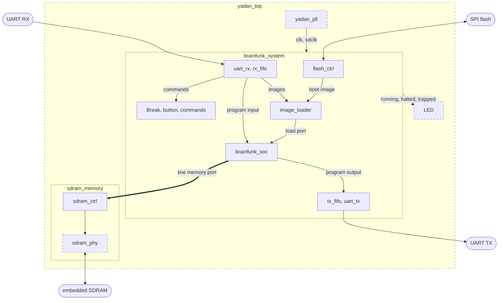
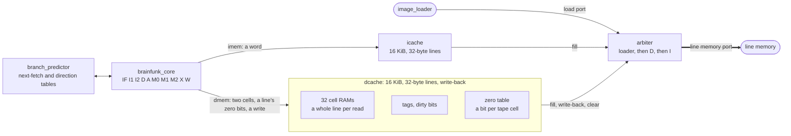
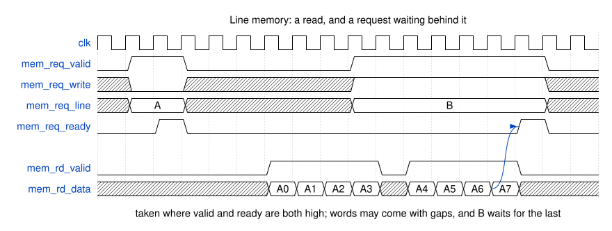
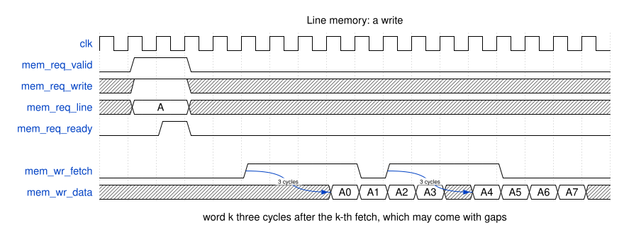
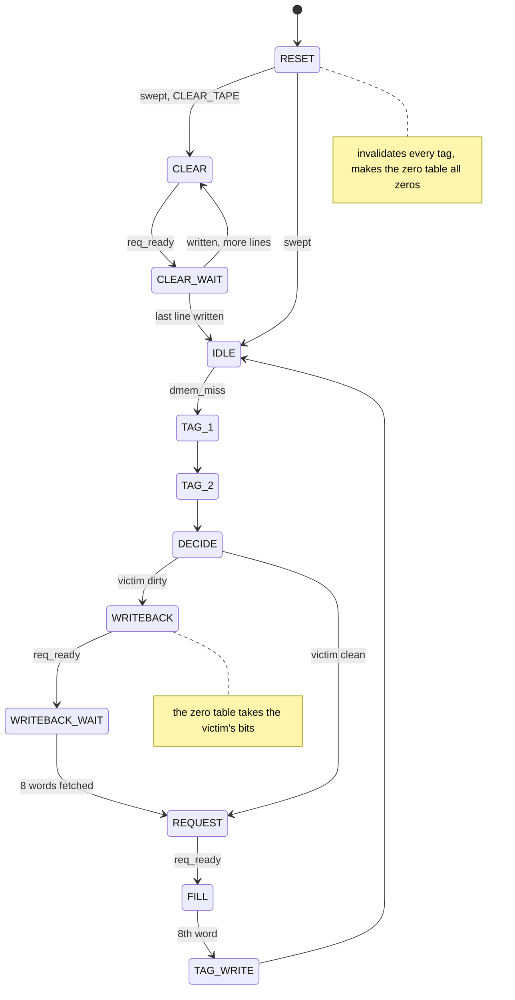

# RTL

`rtl/brainfunk_core.sv` is a scalar pipelined core for the instruction set in
[bitcode.txt](bitcode.txt) and [bincode.txt](bincode.txt), built for clock speed and checked
against the C++ interpreter at every retire. Code and tape live in SDRAM, behind two caches.

It does not implement the fused instructions (`MULC`, `DJN`, `MJN`, `SRUN`) and traps on
them, so programs must come from `-O2` or lower.

```text
rtl/brainfunk_core.sv    the core
rtl/brainfunk_predict.sv next-fetch and direction tables, which only guess
rtl/brainfunk_cache.sv   16 KiB direct-mapped instruction and data caches, 32-byte lines; the data cache reads whole lines
rtl/brainfunk_mem.sv     block RAM behind a registered bank multiplexer
rtl/brainfunk_soc.sv     all of those together, in front of a line memory
rtl/uart.sv              UART and FIFOs
rtl/loader.sv            image loader, into the line memory
rtl/flash.sv             SPI flash: read, erase, program, ID
rtl/brainfunk_system.sv  the SoC with its loader, commands, flash boot and I/O: what any board puts on its pins
rtl/sdram_ctrl.sv        SDRAM controller, as a line memory
rtl/sdram_memory.sv      the controller and the EG4S20's SDRAM pins
rtl/brainfunk_soc_sdram.sv the SoC with that SDRAM, which the cosimulator runs
rtl/board/               the YADAN Board: top, PLL, SDRAM pins; nothing else in rtl/ is particular to a board
tb/                      Verilator cosimulation, SDRAM and flash models, loader, UART and console testbenches
formal/                  SymbiYosys properties and the invariants that make them inductive
synth/                   Tang Dynasty flow for the YADAN Board
src/bfconsole.cpp        loads an image onto the board, and is a console for it
tools/render_diagrams.py renders the timing diagrams in doc/diagrams/, and checks the Mermaid ones
```

On the YADAN Board, the dashed parts are the board's own; another board replaces them, and gives
`brainfunk_system` a clock, its pins and a line memory.



## Pipeline

```text
IF  I1 I2  D   A   M0 M1 M2  X   W
```

| Stage | Work |
|---|---|
| `IF`, `I1`, `I2` | Instruction memory read, three clock edges |
| `D` | Decode; check the next-fetch guess, predict `JE` and `JN`, redirect fetch |
| `A` | `base_ptr` + offset; `M` moves `base_ptr` here |
| `M0`, `M1`, `M2` | Data memory read, three clock edges; `M0` compares addresses with older writes |
| `X` | Result and zero test; resolves branches and the end of `F` |
| `W` | Writes the data memory and retires |

Block RAM sets the shape. On the EG4S20 its clock-to-out is about 4 ns, and each logic level costs
about 1.5 ns with routing, so only a register can follow it. A read is the block RAM, a register
per bank, then a register after the bank multiplexer.

Nothing past `A` stalls, so address comparison in `M0` settles where each operand comes from
before the value exists. `X` only has one multiplexer to go through, because results older
than the instruction right ahead are picked up in `M2`. A read colliding with a write of the same
cell is forwarded, so its undefined result is never used; simulation makes it return wrong data
to keep that true.

Anything younger than an unresolved branch is speculative. It can move `base_ptr`, which is restored,
and read memory. It cannot write, because the flush reaches `X` before it gets to `W`.
Input waits for an empty pipeline. Output acts in `X`, when everything older has been resolved.

## Timing

| Event | Cycles |
|---|---|
| `A`, `S`, `M`, `JE`, `JN` | 1 |
| `MUL` | 1 with a factor of 1 or -1; otherwise 3: source, multiplier, destination |
| `F` | 1 per line reached, plus 7 to end, plus up to 4 waiting for an older write |
| Branch predicted taken, in the next-fetch table | nothing more |
| Branch predicted taken, not in it | 3 more |
| A word that is not a branch, wrongly in the next-fetch table | 3 more |
| Branch mispredicted, or the table's target wrong | 9 more |
| `IO` | about 8, plus waiting for the byte |
| Cache miss, instruction | about 20, holding the front end |
| Cache miss, data | about 30 to restart the instruction, about 20 more to write back a dirty line |

`F` reads a line per cycle, and the read that finds a zero stops the reads behind it; see
[Scanning](#scanning).

On the same images at `-O2`:

| Program | Multi-cycle | Pipeline | With prediction | With line scanning | CPI |
|---|---|---|---|---|---|
| `mandel.b` | 4.96 G cycles | 3.94 G | 3.09 G | 2.84 G | 3.50 → 2.78 → 2.18 → 2.01 |
| `long.b` | | 1.18 G | 0.91 G | 0.91 G | 1.76 → 1.36 |
| `hanoi.b` | 183.2 M cycles | 141.2 M | 74.0 M | 74.0 M | 2.68 → 2.07 → 1.08 |

In `mandel.b`, 42% of the cycles are charged to `MUL` and 11% to `F`. The charge includes the
misprediction before an instruction, which is why `MUL` averages 3.6 cycles. See [Multiplying](#multiplying)
for what came after this table. These programs fit
their caches, which cost them almost nothing. `LostKng.b` does not, and its CPI is about 11.

### Scanning

A cycle of `F` reads a whole 32-byte line, and looks at every cell of it the stride lands on. So its
speed depends on how many of those there are, not on where they fall:

| Stride | Cells per cycle | Where it is |
|---|---|---|
| 1 | 32 | |
| 2 | 16 | `LostKng.b` |
| 4 | 8 | `e.b`, `hanoi.b` |
| 9 | 3.6 | `mandel.b` |
| 16 or more | 1 | Any program: these go a cell at a time, and step `base_ptr` as they go |

Reading a line takes one block RAM per cell, which costs 32 of them against the four of a word-wide
read, but block RAM of that size was plentiful, and it freed four of the large ones. Four independently
addressed byte lanes would have matched this on odd strides, reading the cells of a stride of 9 at
about the same rate, but would have gained nothing on a stride of 4, and needed an adder per lane.

A read is a line, so going to the next one needs no adder: `A` steps the line address, and a table
gives the first cell the stride lands on there, from where it landed in the line before. Backward
strides use the same tables with cells numbered from the end of the line. A mask of the cells to look
at follows the read down the pipeline, built in three steps because it is a 32-way shift.

`dmem_zero` comes straight from the cache, so `F` has no forwarding, and waits while any older write
would still reach the cache after its first read. It stays in `A` until it finishes, so nothing younger
runs alongside it, and its younger reads can be discarded.

`F` never misses. All it needs of a cell is whether it is zero, and a bit for each cell of the tape is
64 Kbit, eight 9K block RAMs: the data cache keeps them as a zero table, read with each line. For a
line in the cache, `F` takes `dmem_zero` from the cache as before; for one that is not, the table's
bits, which are right for every such line: a line goes into the table when the cache writes it back, a
line evicted clean is as it came in, and a reset makes the table all zeros, as the tape starts. Nothing
writes the table while `F` reads it, because only a miss writes back. So `F` goes a line a cycle however
far it reaches, and brings nothing into the cache.

Before, a line that missed restarted `F`, from fetch, and a scan past what the cache holds evicted its
own first lines on the way, so it missed those again when it started over. In the cosimulator, the
eterevsky family's `14.6.b`, which sweeps a growing stretch of tape back and forth, went from 2.27 G
cycles to 136 M, 16.7 times as fast, and `BusyBeaver.b` from 33.1 M to 6.5 M, 5.1 times; `hanoi.b`,
`long.b`, `mandel.b` and `LostKng.b` moved by a few cycles. The issue model, which had `F` go on from
the line that missed, saw only 2.3 times for the first: it missed the restarts. Over its corpus it put
the table at 10.5% fewer cycles (family-weighted geometric mean), all of it in the programs that sweep
long stretches. Nothing else in the memory system came near: open rows, refresh, a victim buffer or
zero-filling never-written lines were each worth under 1%, and a critical word first 2.7%.

Finding the zero is the cheap part. Which cell it was, and so where `base_ptr` ends up, takes two more
cycles after that, because a 32-way search and a subtraction cannot follow the zero test in one. `F`
therefore costs 7 to end, where one cell at a time cost 5. In `mandel.b`, where it reaches about 6
lines, that takes `F` from 22.3 cycles to 12.2, so the ending is now over half of it.

### Multiplying

`MUL` is a read of its source, then a read and write of its destination. The product comes from the
DSP block a cycle after the source's value leaves `X`, so the destination waits a cycle between.

In the corpus, nearly every factor is 1 or -1: 100% of `MUL` in `mandel.b` and `LostKng.b`, though
none in `long.b`. Those need no multiplier: the destination adds or subtracts the source's value as it
left `X` a cycle before, so it follows the source straight away. Everything else still goes through
the DSP block, which takes its factor from the destination in `M2`.

| Program | `MUL` before | `MUL` after | Cycles |
|---|---|---|---|
| `mandel.b` | 3.57 cycles | 2.44 | 2.84 G → 2.47 G |

A factor of 1 or -1 is now one cycle: the destination reads on the first port and the source on a
second, and `X` adds the two, or adds the complement and a carry. The data cache's 32 byte banks each
take their own address, so the second port costs a copy of the tags and a multiplexer per bank; the
core decodes which bank the second port wants as it leaves `A`, so that the multiplexer is all that
comes before the block RAM. Two cells in the same bank of different lines cannot go together, and `D`
tells that from the offsets alone, because both are `base_ptr` plus a constant: those go the old way,
and none of the corpus has any. The source has forwarding of its own, as wide as the first port's, and
the cache gives one hit for both reads, so that `X`'s restart has no more to look at than before.

| Program | `MUL` before | `MUL` after | Cycles |
|---|---|---|---|
| `mandel.b` | 2.44 cycles | 1.85 | 2.47 G → 2.25 G |
| `hanoi.b` | 2.21 cycles | 1.23 | 72.5 M → 71.1 M |

It cost 614 LUTs and one block RAM, at the same 168 MHz. Before it, a `MUL` right after another with
the same source took that source from `mul_operand` instead of reading it; since a factor of 1 or -1
reads both cells at once, only other factors could still do that, and nothing in the corpus does, so it
went.

### Branch prediction

Both tables only guess. The core checks every guess, so a wrong one costs time and nothing else,
which is why formal gives it free guesses and `cosim --chaos` random ones.

The largest cost was not wrong directions but taken branches being right: 0.55 of the 0.74 CPI that
branches cost `mandel.b` with a direction table alone. A table that only improved direction would
save 0.14 CPI there; removing the gap saves 0.67.

The next-fetch table has 16 entries, in logic rather than block RAM so it can answer in one cycle.
It is looked up with the address fetched one slot before the word it predicts, so its answer is in
registers by the time that word is fetched, and the fetch after it goes to the target with no gap.
That slot can be anything, a word on a wrong path included, because the same path through a program
gives the same slots. A hit is taken as taken, without asking the direction table. `D` then learns
what the word is. If it is not a branch, what follows is fetched again. If it is, `A` compares the
target, and `X` treats a wrong one as a misprediction, which keeps the comparison off the path to
`fetch_pc`. Entries match on 8 address bits above the index; a false match only costs its check.

Entries go in when `D` redirects fetch to a taken branch, and come out when a guess proves wrong.
Keeping them would be better for `bottles.b` (CPI 1.79 against 2.08) and `e.b`, where the same
branch is taken again soon, and much worse for `fib.b` (2.83 against 1.42) and `squares.b` (2.40
against 1.91). Two-bit hysteresis might get both, at the cost of updating the entry on every hit.

The direction table has 4096 2-bit counters in one block RAM, read to arrive with the word in `D`.
It decides when the next-fetch table has no opinion. A counter written as it is read reads as anything,
as block RAM does, so such a write is left out. Simulation makes that read wrong on purpose, and
leaving the write out took `mandel.b` from 1.590 CPI to 1.503; keeping it for a cycle later would have
made it 1.501. Passing the write along to the read did as well, but put a multiplexer on the way from
the block RAM to `fetch_pc`, which missed 168 MHz by 0.4 ns. On the corpus, 1024 counters do as well as
4096, but a block RAM of 9 Kbit holds either. Each counter counts how far the branch disagrees
with backward taken, forward not taken, so zeros start out as that guess, and counters that are
shared tend to agree. The static guess was wrong 92% of the time on `LostKng.b`, whose branches are
mostly forward and taken; with the table, 2.6%.

Modelled on the corpus, global and local history gave no clear gain over this: `gshare` with the
history it could really have at fetch was worse on `mandel.b` (9.9% wrong against 9.0%). The tables
are also small against `LostKng.b`, where the model shows 4096 next-fetch entries cutting branch cost
from 1.24 to 0.47 CPI. That would need block RAM and a slower answer, for 7% of a CPI of 11 that is
mostly instruction cache misses.

### Tried and removed

Two larger steps were built and verified, and then taken out again, because what
matters is the clock times the instructions per cycle, and neither paid for its clock. Tag
`rtl-dual-issue` has both, with their documentation.

- Early resolution: a 4-cell store of known values kept in `A`, and a zero bit per tape cell in 8 block
  RAMs, so that a branch whose cell's value was known resolved in `M0` for 6 cycles rather than 9.
  About 900 LUTs and 8 block RAMs; `mandel.b` 1.590 to 1.517 CPI. It missed 168 MHz by 0.17 to 0.9 ns.
- Dual issue: two words a cycle into a queue of four, and pairs of `A`, `S`, `M`, `JE` and `JN` on
  different cells, the second on the data cache's second port. About 9900 LUTs against 5500;
  `mandel.b` 1.517 to 1.248 CPI, but at 120 to 130 MHz.

Over the corpus (`tools/issue_sweep.py`, 93 programs in 29 families, each family counting once), the
issue model, caches and SDRAM included, gives these, each changing one thing in the core as it is:

| Change | Cycles saved |
|---|---|
| Line scanning, against a cell per cycle (already in) | 24%, mostly in a few families |
| A factor of 1 or -1 in one cycle (already in) | 4% |
| A memory that never misses | 19% |
| `IO` in 2 cycles rather than 7 | 7% |
| `F` ending in 2 cycles rather than 8 | 5% |
| Early resolution, both guesses | 3% |
| Dual issue, with early resolution | 19% |
| Dual issue, without | 17% |
| A cycle more or less of misprediction | 1% |
| A static guess in place of the tables | 27% more cycles |
| 8 or 64 next-fetch entries, 256 or 1024 counters | within 1% |

Dual issue would need about 135 MHz to match the scalar core at 168. Four-wide, with every read and
write port it could want, would save 44% of the cycles, or 58% with a memory that never misses: the
wider the core, the more the memory matters. Against the cosimulator the model is within 4% on average
over the corpus, mostly optimistic; see doc/analysis.md.

## Memory

`brainfunk_soc` reaches memory through a line memory port: one 8-word line at a time, read as 8
words in order, written by fetching 8 words, with the next request not taken before a read's last
word. Its comment has the details. `sdram_ctrl` is one; another board's memory, behind its own
controller, would be another.



A read, and a request from another client waiting for it to finish, since the next request takes
the read data over:



A write: the client has three cycles from each fetch to put the word out, which is what a block RAM
read and its registers take.



| Line memory word address | Contents |
|---|---|
| `0x000000` | Code, one instruction per word |
| `0x100000` | Tape, four cells per word, the lowest address in the low byte |

The caches keep the core's three-edge memory latency, so the pipeline did not change shape for
them. Each hit flag is a registered comparison arriving with the data.

An instruction miss holds the front end while the line fills. If a redirect abandons the
instruction that missed, fetching carries on, and the line is still filled.

A data miss is found in `X`. The instruction has written nothing by then, so it flushes itself
and everything younger and restarts from fetch, the same as a misprediction back to itself, while
`A` waits for the cache. Nothing past `A` stalls, so forwarding did not change. Two rules follow:
a restarted instruction must find everything in the cache at once, which holds because `MUL`'s two
cells are about 2 KiB apart at most; and input reads its cell before taking a byte, so that its
write cannot miss, because a byte taken cannot be asked for again.

The data cache, from a miss to the line it brings in:



### SDRAM

The EG4S20NG88 embeds a 2M x 32 SDRAM. The controller moves whole lines, always with
auto-precharge, at CAS latency 3 with tRCD 4, tRP 4, tRFC 12, and refresh every 7 us.

The part is an Etron EM638325, four banks of 2048 rows by 256 columns, in its -5 speed grade, rated to
200 MHz at CAS latency 3. Tang Dynasty has no timing for it: its simulation model is an empty shell.
Nor has the current Anlogic datasheet, DS301 v2.7.8, which only names the part; DS301 v2.6 (March
2020) had its AC parameters as Table 4-1 of section 4, and they are the -5 column of the Etron
datasheet (Rev 1.4, October 2005, "Recommended A.C. Operating Conditions"):

| Parameter | -5 | This controller at 168 MHz |
|---|---|---|
| tCK at CAS latency 3 | 5 ns min | 5.95 ns |
| tRCD, activate to read or write | 18 ns | 4 cycles, 23.8 ns |
| tRP, precharge to activate | 15 ns | 4 cycles, 23.8 ns |
| tRC, activate to activate, and an auto refresh | 55 ns | 12 cycles, 71.4 ns |
| tRAS, activate to precharge | 35 ns to 100 us | about 12 cycles |
| tRRD, activate to activate in another bank | 10 ns | one bank at a time |
| tWR, write recovery | 2 cycles | 2 cycles |
| Refresh | 4096 in 64 ms, one per 15.6 us | one per 7 us |
| tAC, clock to data out at CAS latency 3 | 4.5 ns max | |
| tOH, data out hold | 2 ns | |
| tIS, tIH, input set-up and hold | 1.5 ns, 1 ns | |

So data from the part is valid for tCK - tAC + tOH, 3.45 ns at 168 MHz, of which the measured window
below is about 1.36 ns once the FPGA's own paths have taken theirs. tRCD 3 is 17.9 ns at 168 MHz, just
short of 18, which is why it running clean below is margin and not a setting.

The part's clock is a separate PLL output. Measured at 168 MHz on one board at room temperature,
with Memtest86+-style patterns plus every data bit toggling per word and bit-reversed line order,
there were no errors over all 8 MiB with the SDRAM clock from 195 to 277.5 degrees after the core
clock, and errors at 187.5 and 285. `rtl/board/yadan_pll.sv` uses 240. On the same board tRCD 3
cycles, CAS latency 2, and refresh every 240 us also ran clean, which is margin, not a target.

The SDRAM needs about 100 ms after power-up. A 300 us wait lost data in the first pass.

#### At 192 MHz

5.21 ns is still within the -5 grade, and the controller's cycle counts all still meet its timing: tRCD
and tRP 20.8 ns, tRC 62.5 ns, refresh every 6.1 us. The data window is what shrinks, to 2.71 ns from the
part. With `tools/sdram_sweep.py --mhz 192 phase`, in steps of 9 degrees, two sweeps on one board:

- Four cycles after READ, as at 168 MHz, only 216 degrees was ever clean, and on the second sweep it was
  not: 16700 errors.
- Five cycles after READ, 306 to 324 degrees and 360 to 369 were clean both times. Next to them, 288,
  333 and 342 were clean in one sweep and not the other. Each angle is a bitstream of its own, placed
  anew, which is a likely reason the edges move.

So 192 MHz takes `YADAN_SDRAM_DEGREES=315` and `YADAN_SDRAM_CAPTURE=5`, a cycle more per line read.
That cycle also has to be waited out: at `CAPTURE` 4 a read's last word arrives in the very cycle the
next request may take the read data over, and at 5 it went to the wrong cache until `READ_RECOVER`
grew with it. `test_sdram_data_a_cycle_late` simulates it, with `SDRAM_PIN_DELAY` in the model.

## Verification

The hardware tests are in `tests/hw`, in pytest, and need `pytest`, `pytest-xdist` and `filelock`; formal
needs SymbiYosys and Bitwuzla. ctest runs them, as tests labelled `hw`, `formal`, `mutation` and `board`;
the last two only when configured with `BRAINFUNK_TEST_MUTATION` or `BRAINFUNK_TEST_BOARD`. pytest on its
own builds what it needs first.
Each range of random seeds and each program is a test of its own, so a failure can be rerun by name.
Everything runs at nice 19.

```shell
ctest --preset hw                     # cosimulation, loader, UART and console testbenches, formal, 2.5 minutes
cmake -B build -DBRAINFUNK_TEST_MUTATION=ON -DBRAINFUNK_TEST_BOARD=ON   # register those too
pytest -n auto tests/hw               # the same through pytest alone
pytest -n auto --full                 # also long.b and mandel.b, about 40 minutes
pytest -n auto --mutation             # broken designs must be caught, 4 minutes
pytest --board                        # the real board, from build/yadan/yadan.bit; needs TD_HOME and pyserial
pytest --board --flash                # also programs the user flash, which wears out, so only on request
pytest -k "evict and seed_5"          # one test by name
tools/sdram_sweep.py phase            # measure the SDRAM's clock window on the board
```

The cycle counts of the real programs end up in `build/hw-test/cycles.json`.

**Cosimulation** runs the core in lock step with `libbrainfunk`. At every retire it compares
pc, next pc, `base_ptr`, the write address and data, and output; at the end it compares the
whole tape, through the data cache. `tb/sdram_model.sv` stops the simulation on any command or
timing the part would not accept. `brainfunk -m hex` produces the image, and the interpreter loads
the same file with `load_bincode`, so the encoder and decoder are covered too. Input stalls and output
backpressure can be randomized with `--stall`. `--evict` runs images that jump between cells a
whole cache size apart: nothing in the test corpus evicts a dirty line, so nothing else tests
write-back.

**The loader** is tested on its own with the controller and SDRAM model, `tb/loader_tb.sv`: images
that copy from the line being filled, overlapping themselves, across lines, and from up to 65535 words
back, and `LostKng.b`, must end up in SDRAM word for word, packed or not; one image after another
must not reuse what was read for the first; a corrupt one must be refused, and so must one with a
right CRC and a header this loader cannot take. `tb/uart_tb.sv` covers the board top.

**The console** is `tb/console_tb.sv`, the board top as `bfconsole` sees it, for each end of input:
the answer to framing, `FF` and `13` in the output, an echo slow enough to fill the receive FIFO
from a host that sends 150 bytes more after each stop, the end of input sent while the FIFO still
holds the echo's input, the end of the program only after its output, a restart turning framing
off, and a trap.

**Formal** checks the core against abstract memories: two tape cells and one instruction word,
at addresses the solver picks, behave like real memory with its latency, and every other read
returns anything. The caches' signals are free too, so any access may miss and any stall can
happen. So the properties cover every cell and every pair of cells, and words that no compiled
program contains. They state that whatever reaches `W` is on the program's path and is the word at
that pc; the pc and `base_ptr` rules; results on architectural cell values, which covers
forwarding; writes only at retire and at the effective address; sticky halt and trap, exactly on
illegal words; one I/O byte per instruction, and an end of input that keeps the cell writing it back
as it was; and no lost output. The caches and controller
are not covered by formal, only by cosimulation.

The proof is unbounded: k-induction over `formal/core_invariants.svh`, which says how every stage of
the pipeline relates to what has retired, in any state the core can reach. Among other things: the
fields each stage decoded from its word; the path from the last retire through each stage to fetch,
broken only where a guess is already known to be wrong; where each read's value comes from, for every
older write still in flight; the two halves of `MUL`, input and output; and for `F`, a cursor up to
which every cell it lands on is known to be non-zero, with each read in flight starting where the one
before left off. With those, three steps of induction prove the properties for every run, of any
length, from reset.

It runs at two sizes, both with every cache signal free and with `F` and I/O: 16 cells in lines of
4, strides up to 3; and lines of 8, strides up to 7. Two lines are not enough, because a backward
scan going forward a line looks the same. `prove` and `prove_lines` replace the multiplier with an
XOR on both sides, and `prove_multiplier` keeps the real one. With Bitwuzla they take under a minute; yices took four times as long.
Larger sizes did not finish within an hour.

The proof covers what can go wrong, not what fails to happen: a core that stops making progress
proves as well as one that runs. `latency` bounds that for everything but `F` and `IO`, to 28
steps; cosimulation covers the rest. `cover` shows that every kind of retire is reachable, so that
the proofs are not vacuous. Formal mutants are checked against the proof.

## YADAN Board

The board has an Anlogic EG4S20NG88. `rtl/board/yadan_pll.sv` makes 168 MHz from its 24 MHz clock.

The clock is a build option. The yadan target takes `YADAN_MHZ`, a multiple of 24, with the SDRAM's
phase and capture measured for it as `YADAN_SDRAM_DEGREES` and `YADAN_SDRAM_CAPTURE`:

```shell
cmake -B build -DYADAN_MHZ=192 -DYADAN_SDRAM_DEGREES=315 -DYADAN_SDRAM_CAPTURE=5
```

168 MHz is where timing closes, at the slow corner. 192 MHz does not: four builds had minimum periods
from 5.74 to 6.16 ns, and the one on the board 5.74, so it runs on the part being 10% faster than that
corner.
On one board at room temperature, over JTAG, it passed the board tests and five rounds of six corpus
programs compared byte for byte, and ran `mandel.b` in 11.32 s against 12.87 at 168, 1.137 times as
fast against 1.143 for the clock alone. That is one board, one temperature: an overclock, with no
margin known, and a failure would be wrong data rather than a stop. Comparisons between designs are
made at timing that closes.

```shell
export TD_HOME=/path/to/TD
cmake --build build --target yadan       # build/yadan/yadan.bit and reports
cmake --build build --target yadan-load  # JTAG to SRAM; the configuration flash is not touched

build/bin/bfconsole -f program.b             # compile, into Code RAM, run it, and talk to it
build/bin/bfconsole -e 0 -f program.b        # the same, with an end of input that stores 0
build/bin/bfconsole -m flash -f program.b    # into the user flash, boot from it, and talk to it
build/bin/bfconsole program.bfi              # an image instead, in any form brainfunk -b reads
build/bin/bfconsole                          # a console for what the board is running
build/bin/bfconsole -n -f program.b          # load it, and return
build/bin/bfconsole -e 0 -i input.txt -o output.txt -t 10000 -f program.b < /dev/null
build/bin/bfconsole -m id                    # the user flash's JEDEC ID
build/bin/brainfunk -O2 -e 0 -m packed -f program.b -o program.bfi   # what bfconsole sends
```

`bfconsole` is a console in the manner of busybox microcom: at a terminal, `^X` exits and `^D` ends
the input; `-X` sends both as they are. It echoes what is typed (`-L` does not), Enter sends LF, and
the program's LF shows as CR LF. Output to a file or a pipe is byte for byte, and `-o` writes a copy.
It exits when the program halts (0) or traps (3), at `^X` (0), or after `-t` milliseconds with
nothing either way (4). It owns the port while it runs, so the settings it needs, raw, `HUPCL` and no
flow control of the kernel's, are not left to another tool.

`bfconsole` finds the board's serial port as the only one under `/dev/serial/by-id` from USB vendor
`1a86`, the board's CH340; `-p` or `BOARD_PORT` picks one instead. The tests and
`tools/sdram_sweep.py` find it the same way.

The yadan-load target needs access to the USB cable, `336c:1002`, which a udev rule can give:

```text
SUBSYSTEM=="usb", ATTR{idVendor}=="336c", ATTR{idProduct}=="1002", MODE="0660", GROUP="uucp", TAG+="uaccess"
```

What happens when:

| Event | Effect |
|---|---|
| Power-up | Load Code RAM from the user flash, and run it; with a bad or empty flash, wait for a Break |
| `K_51`, 5 ms or longer | The same |
| Opening the serial port, if closing it dropped RTS | RTS pulses the same net for about 137 us: restart the program from Code RAM |
| UART Break, 100 ms or longer | Whatever is going on, take a command at the loader's speed |
| UART Break, 10 to 100 ms | Turn framing on, and answer with the image's flags |
| UART Break, 1 to 10 ms | The end of input, after every byte sent before it |
| Any restart | Clear the tape and caches, turn framing off, then wait about 200 ms so the first output is not lost |

Closing the port only drops RTS with `HUPCL` set. minicom clears it, and that outlives the port being
closed, so no terminal restarts the program afterwards. `stty -F <port> hupcl` before connecting puts
it back; so does running `bfconsole`.

Program I/O is 115200 8N1, through 1 KiB FIFOs. The loader runs at 2 Mbaud. `LED_23` is on while
running, off when halted, blinks on a trap, and flashes quickly while there is no program or one is
being loaded.

RTS drives the reset net, so there is no flow control in hardware, and the only signal from the host
that no byte can be is a Break, which the board tells apart by length. Nothing from the board is out
of band: a Break from it reads on the host as a plain 0, `PARMRK` or not. So what the board has to
say besides the program's output goes in band, framed, once a host has asked for it:

| From the board, framed | Means |
|---|---|
| `FF FF` | an `FF` byte of output |
| `FF 13`, `FF 11` | stop sending, send again: the receive FIFO is half full, then down to a quarter |
| `FF 46` and a byte | framing is on; bit 7 is set if there is a program, bits 1:0 are its end-of-input field |
| `FF 48`, `FF 54` | the program has halted (`H`), or trapped (`T`), and all its output is out |

Any other byte is output. A host without framing sees the board as it was, with no flow control
and no end of input; framing lasts until the program restarts, which opening the port does, and
through commands, whose answers are not framed. The input the host sends is never changed.

The end of input is what the image says it stores, in its header (bincode.txt): 0, 255, or the cell
as it was. An image that says nothing has none, and its input waits for ever, as before; a Break
that short is then nothing.

The CH340, measured on the board with a design that timed the line, at 24 MHz: a Break held with
`TIOCSBRK` for 0.2 to 1 ms arrived as 2.000 ms each time, and from 2 to 50 ms as 1 ms more than
asked, with no spread over 20 tries each; `tcsendbreak` gave 267 ms. So `bfconsole` asks for 1 ms,
30 ms and 250 ms, each well inside its range. A single `write()` hands the driver up to 4160 bytes at
once, which would all arrive after a stop, so the kernel's own XON/XOFF could not protect the FIFO.
`bfconsole` sends 64 bytes at a time and waits for each to drain: what reached the board after its
stop was then 128 bytes in that measurement, against the 512 left. `tcdrain()` returns once the
driver has handed its bytes to the CH340, which may still hold some: a Break straight after cut about
the last 50 short, on the board, so `bfconsole` waits 20 ms more before any Break. Without framing, a
program reading at about a third of the line's speed echoed 4418 of 8192 bytes sent at once.

After a command Break the host sends a command byte, and images are in the format in
[bincode.txt](bincode.txt):

| Command | Then | Answers |
|---|---|---|
| `R` | The image | `K`, or `E` if it is bad |
| `F` | Image length (3 bytes, little endian), then 256-byte pages, padded with `FF` | `R` after erasing, `.` after each page. Then it boots from the flash, which checks the CRC |
| `I` | Nothing | The flash's 3-byte JEDEC ID |

The user flash on the board reads as `C8 40 15`, a GigaDevice part compatible with the W25Q16.

The loader writes each line to SDRAM as soon as it is whole, and a copy reads its source back from
there, so a copy can reach as far back as its 16-bit distance, 65535 words, and the loader needs two
lines of buffer instead of a window: the line being filled, which a copy may read from too, and the
last line read back. A copied word takes 6 cycles, and a line read about 20 more, against 840 cycles
for each byte at 2 Mbaud. It takes bincode images as well as packed ones, and refuses any other
version of the header; doc/bincode.txt has what it checks. With the window of 8192 words of block RAM it had before, `LostKng.b` packed
to 82 KB; now it packs to 71 KB, and 8 of the 12 large block RAMs in use came free.

A yadan build reports timing violations on the SDRAM's own pads, from constraints Tang
Dynasty adds there; the data path they describe is covered by the measured capture phase above.
Everything else has to meet timing, which `timing.rpt` shows under `pll/pll.clkc[0]`.

Tang Dynasty's `read_verilog` elaborates each file as it reads it, so the build concatenates
the sources. It stays at its prompt after an error and then exits successfully, so
`synth/build-yadan.sh` closes its input and checks the log. With the SDRAM in a design, `place`
finishes and then raises an error with an empty message, so `synth/yadan.tcl` catches it. It also
crashes with a backtrace if it cannot open the JTAG cable, and exits successfully then too.
